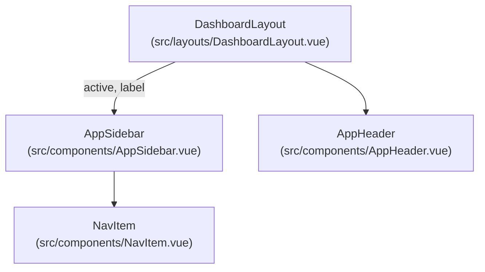

# get_component_tree — SSOT Component Hierarchy Topology & Blast Radius Analysis

**Status:** Single Source of Truth (SSOT)  
**Feature Owner:** Tool Call `get_component_tree` (`src/tools/component-tree.ts`)  
**Last Updated:** 2026-11-11  

---

## 1. Purpose & Business Requirements

Modern frontend UI architecture is organized into nested component hierarchies:
* **Developer & AI Agent Problems:**
  * When modifying a low-level presentational component (e.g., a button or form input), agents have no visibility into which pages or layouts will be impacted (*blast radius*).
  * When analyzing a large layout, reading hundreds of lines of template markup wastes context tokens just to determine which child components are rendered.
  * Architectural antipatterns like **Props Drilling** (passing props through 3–4 intermediate component layers) frequently escape agent detection.
* **The `get_component_tree` Solution:**
  Provides instant component hierarchy topology in two directions (*downward* and *upward*), automatically detects props drilling, audits context provision (*provide/inject* & *useContext*), and supports direct resolution from URL routes (e.g., `/dashboard`) to page entrypoints and their layout chains.

---

## 2. Input Specifications (Parameters & Aliasing)

| Parameter | Type | Required? | Description & Aliasing |
|---|---|---|---|
| `path` | `string` | Conditional* | Root or entry component file (Aliases: `entry_path`, `entryPath`, `file_path`, `filePath`, `component`). |
| `route` | `string` | Conditional* | URL route to analyze (e.g., `"/dashboard"`, `"/catalog/[id]"`). Automatically locates page entrypoints (Alias: `route_path`). |
| `direction` | `'downward' \| 'upward' \| 'down' \| 'up'` | Optional | Traversal direction: `'downward'` (root &rarr; children) or `'upward'` (leaf &rarr; parent consumers / blast radius). Default: `'downward'`. |
| `max_depth` | `number` | Optional | Traversal depth limit (default: `3`, alias: `depth`). |
| `include_props`| `boolean` | Optional | Display props and data bindings passed to child components (`childProp <- parentExpr`). Default: `true`. |
| `target_path` | `string` | Optional | Project root directory (default: `"."`, aliases: `root`, `workspace_root`). |
| `scope_filter` | `string` | Optional | Domain/module scope filter (e.g., `"apps/web"`, `"features/auth"`, alias: `scope_path`). |
| `alias_map` | `object` | Optional | Custom path alias map overriding `tsconfig.json` / `jsconfig.json` detection. |
| `limit` | `number` | Optional | Item limit returned for upward traversal (default: `20`). |
| `format` | `'text' \| 'json' \| 'mermaid'` | Optional | Output format: `'text'` (indented tree), `'json'`, or `'mermaid'` (visual flowchart diagram). |

*\*Note: Either `path` or `route` must be provided.*

---

## 3. Technical Mechanics & Algorithm

### A. URL Route to Page Entrypoint Resolution (`route: "..."`)
When provided with a URL route:
1. Strata runs a route scan (`scanRoutes`) that recognizes standard conventions:
   * **Next.js App Router:** `app/**/page.tsx`
   * **Next.js Pages Router:** `pages/**/*.tsx`
   * **Nuxt 3:** `pages/**/*.vue`
   * **SvelteKit:** `src/routes/**/+page.svelte`
   * **Astro:** `src/pages/**/*.astro`
2. Resolves dynamic route parameters (e.g., `/catalog/123` &rarr; matches pattern `/catalog/[id]`).
3. Includes the full wrapping **Nested Layout** chain (e.g., `RootLayout` &rarr; `DashboardLayout` &rarr; `SettingsPage`).

### B. Downward Traversal (`direction: "downward"`)
1. **Rendered Tags Extraction:** Parses the template AST (Vue template DOM or React JSX) to identify custom tags that are **actually rendered**.
2. **Dynamic Components & Dictionary Maps:** Resolves `<component :is="...">` by traversing TypeScript AST component dictionaries (e.g., `const tabs = { home: HomeView, profile: ProfileView }`).
3. **Props Passing Extraction:** Captures data bindings on child tags:
   * Static: `title="Dashboard"`
   * Dynamic: `:user="currentUser"`, `v-model="searchQuery"`
4. **Props Drilling Detection:**
   Tracks the chain of prop forwarding. If a prop is passed across $\ge 2$ intermediate layers without being utilized locally, Strata issues a **`PropsDrillingAlert`** complete with recommendations to introduce a store or provide/inject.
5. **Context Integrity & Dangling Context:**
   Tracks `provide` and `inject` (Vue) or `<Context.Provider>` and `useContext` (React). Issues warnings if a child component calls `inject('key')` but no ancestor in the tree provides it.
6. **Cycle Detection (`CYCLE_TRUNCATED`):**
   Prevents recursive loops (e.g., `TreeMenu.vue` rendering itself). Recursive nodes are flagged with `isCircular: true` and depth recursion halts.

### C. Upward Traversal (`direction: "upward"` — Blast Radius)
1. **Sub-10ms SQLite `graph.db` Query:**
   Reads reverse dependency relations from the `edges` table (`child_file_id = target.id`) in $<10$ milliseconds.
2. **Component Name Disambiguation:**
   If a consumer has a generic name like `index.vue`, Strata automatically disambiguates it using its parent directory name (e.g., `Sales/Index.vue` or `Auth/Login.tsx`).
3. **Consumer Categorization:** Differentiates page-level consumers (*Pages/Views*) from intermediate components (*Intermediary Components*).

---

## 4. Language & Framework Support

* **Vue 3 & Nuxt 3 (`.vue`):** Auto-imported components, SFC template AST (`@vue/compiler-dom`), dynamic component resolution, provide/inject.
* **React & Next.js (`.tsx`, `.jsx`):** JSX element AST, Context Provider/useContext, Transitive Hydration Boundary (`transitiveBoundary: "client-hydrated (inherited from parent)"`).
* **Svelte 4 & 5 (`.svelte`):** Svelte templates, Context API (`setContext`/`getContext`), Snippets.
* **Astro (`.astro`):** Astro islands hydration directives (`client:load`, `client:visible`).
* **Inertia.js & Vue Router:** Handles `<RouterView>` and Inertia page wrappers.

---

## 5. Output Structure & Example Responses

### Default Text Format (`format: "text"`):
```text
DashboardLayout (src/layouts/DashboardLayout.vue)
├── AppSidebar (src/components/AppSidebar.vue)
│   └── NavItem (src/components/NavItem.vue) [props: active <- currentRoute.name, label <- item.title]
├── AppHeader (src/components/AppHeader.vue)
│   └── UserDropdown (src/components/UserDropdown.vue) [props: user <- currentUser]
└── ContentSlot (Dynamic RouterView)

[CONTEXT INVENTORY]
- Provided: "theme" (line 24), "authSession" (line 28)
- Consumed: none

[ALERT: PROPS DRILLING DETECTED]
Prop "themeMode" drilled from DashboardLayout -> AppSidebar -> NavItem (Depth: 3).
Recommendation: Consider Pinia/Zustand or Provide/Inject to eliminate deep 3-level props drilling.

Summary: 5 components explored, 1 layout chain, 1 drilling alert.
```

### Mermaid Diagram Format (`format: "mermaid"`):


---

## 6. Code Implementation References

* **Tool Definition Catalog:** [`src/tools/catalog.ts`](../../src/tools/catalog.ts)
* **Primary Handler:** [`src/tools/component-tree.ts`](../../src/tools/component-tree.ts)
* **Downward Engine:** [`src/engine/graph/downward-traversal.ts`](../../src/engine/graph/downward-traversal.ts)
* **Upward Engine:** [`src/engine/graph/upward-traversal.ts`](../../src/engine/graph/upward-traversal.ts)
* **Props Drilling Detector:** [`src/engine/graph/props-drilling.ts`](../../src/engine/graph/props-drilling.ts)
* **Context Analyzer:** [`src/engine/graph/context-analyzer.ts`](../../src/engine/graph/context-analyzer.ts)
* **Route Resolver:** [`src/engine/routes.ts`](../../src/engine/routes.ts)
