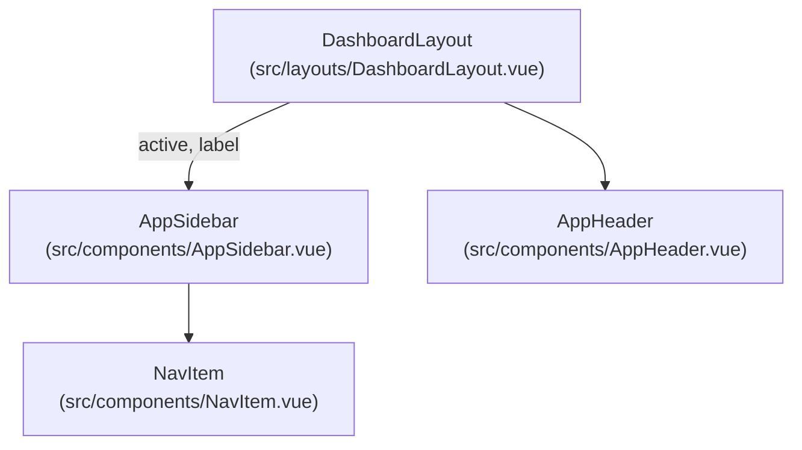

# get_component_tree — SSOT Topologi Hirarki Komponen & Analisis Blast Radius

**Status:** Single Source of Truth (SSOT)  
**Pemilik Fitur:** Tool Call `get_component_tree` (`src/tools/component-tree.ts`)  
**Terakhir Diperbarui:** 2026-11-11  

---

## 1. Tujuan & Kebutuhan Bisnis

Struktur UI frontend modern berbasis hierarki bersarang (*nested components*).
* **Masalah Pengembang & AI Agent:**
  * Saat mengubah komponen presentasional di level bawah (misal: tombol atau form input), agent tidak tahu halaman atau layout apa saja yang akan rusak (*blast radius*).
  * Saat mengamati sebuah layout besar, membaca ratusan baris markup template menghabiskan token konteks hanya untuk mengetahui komponen anak apa saja yang dirender.
  * Masalah arsitektural seperti **Props Drilling** (prop dioper melewati 3-4 layer komponen perantara) sering luput dari pengamatan agent.
* **Solusi `get_component_tree`:**
  Menyajikan topologi hierarki komponen secara instan dalam dua arah (*downward* dan *upward*), mendeteksi props drilling secara otomatis, mengaudit penyediaan konteks (*provide/inject* & *useContext*), serta mendukung resolusi langsung dari URL Route (misal: `/dashboard`) menuju page entrypoint dan rantai layout-nya.

---

## 2. Spesifikasi Input (Parameter & Aliasing)

| Parameter | Tipe | Wajib? | Deskripsi & Aliasing |
|---|---|---|---|
| `path` | `string` | Bersyarat* | File komponen awal/root (Alias: `entry_path`, `entryPath`, `file_path`, `filePath`, `component`). |
| `route` | `string` | Bersyarat* | URL route yang ingin dianalisis (misal: `"/dashboard"`, `"/catalog/[id]"`). Otomatis mencari page entrypoint (Alias: `route_path`). |
| `direction` | `'downward' \| 'upward' \| 'down' \| 'up'` | Opsional | Arah traversal: `'downward'` (root &rarr; children) atau `'upward'` (leaf &rarr; parent consumers / blast radius). Default: `'downward'`. |
| `max_depth` | `number` | Opsional | Batas kedalaman traversal (default: `3`, alias: `depth`). |
| `include_props`| `boolean` | Opsional | Menampilkan prop dan binding data yang dioper ke komponen anak (`childProp <- parentExpr`). Default: `true`. |
| `target_path` | `string` | Opsional | Direktori root proyek (default: `"."`, alias: `root`, `workspace_root`). |
| `scope_filter` | `string` | Opsional | Filter cakupan domain/modul (misal: `"apps/web"`, `"features/auth"`, alias: `scope_path`). |
| `alias_map` | `object` | Opsional | Peta alias path kustom yang meng-override deteksi `tsconfig.json` / `jsconfig.json`. |
| `limit` | `number` | Opsional | Batas item yang dikembalikan untuk upward traversal (default: `20`). |
| `format` | `'text' \| 'json' \| 'mermaid'` | Opsional | Format keluaran: `'text'` (pohon terindentasi), `'json'`, atau `'mermaid'` (flowchart diagram visual). |

*\*Catatan: Salah satu dari `path` atau `route` wajib disediakan.*

---

## 3. Cara Kerja Teknis & Algoritma

### A. Resolusi URL Route ke Page Entrypoint (`route: "..."`)
Jika agent memberikan URL route:
1. Strata menjalankan pemindaian rute (`scanRoutes`) yang mengenali konvensi:
   * **Next.js App Router:** `app/**/page.tsx`
   * **Next.js Pages Router:** `pages/**/*.tsx`
   * **Nuxt 3:** `pages/**/*.vue`
   * **SvelteKit:** `src/routes/**/+page.svelte`
   * **Astro:** `src/pages/**/*.astro`
2. Menghubungkan parameter rute dinamis (misal: `/catalog/123` &rarr; cocok dengan pattern `/catalog/[id]`).
3. Mengikutsertakan rantai **Nested Layout** (misal: `RootLayout` &rarr; `DashboardLayout` &rarr; `SettingsPage`).

### B. Arah ke Bawah (`direction: "downward"`)
1. **Rendered Tags Extraction:** Mem-parsing template AST (DOM template Vue atau JSX React) untuk mengidentifikasi tag kustom apa yang **benar-benar dirender**.
2. **Dynamic Component & Dictionary Maps:** Mampu membaca `<component :is="...">` dan menelusuri variabel kamus komponen di AST TypeScript (misal: `const tabs = { home: HomeView, profile: ProfileView }`).
3. **Props Passing Extraction:** Mengambil data binding pada tag anak:
   * Statis: `title="Dashboard"`
   * Dinamis: `:user="currentUser"`, `v-model="searchQuery"`
4. **Props Drilling Detection:**
   Algoritma melacak rantai passing prop. Jika prop diteruskan melompat $\ge 2$ layer tanpa dimanfaatkan secara lokal, Strata menghasilkan **`PropsDrillingAlert`** lengkap dengan rekomendasi penggunaan store atau provide/inject.
5. **Context Integrity & Dangling Context:**
   Mencatat `provide` dan `inject` (Vue) atau `<Context.Provider>` dan `useContext` (React). Memperingatkan jika ada komponen anak yang memanggil `inject('key')` tetapi tidak ada leluhur (*ancestor*) dalam pohon yang menyediakannya.
6. **Cycle Detection (`CYCLE_TRUNCATED`):**
   Mencegah perulangan rekursif (misal: `TreeMenu.vue` merender dirinya sendiri). Node rekursif ditandai `isCircular: true` dan pemotongan kedalaman dihentikan.

### C. Arah ke Atas (`direction: "upward"` — Blast Radius)
1. **Query Kilat via SQLite `graph.db`:**
   Membaca tabel `edges` relasi reverse dependency (`child_file_id = target.id`) dalam hitungan $<10$ milidetik.
2. **Disambiguasi Nama Komponen:**
   Jika konsumen bernama generik seperti `index.vue`, Strata secara otomatis menamai dengan nama folder induknya (misal: `Penjualan/Index.vue` atau `Auth/Login.tsx`).
3. **Kategorisasi Konsumen:** Membedakan mana konsumen level halaman (*Pages/Views*) dan mana yang merupakan komponen perantara (*Intermediary Components*).

---

## 4. Dukungan Bahasa & Framework

* **Vue 3 & Nuxt 3 (`.vue`):** Auto-imported components, SFC template AST (`@vue/compiler-dom`), dynamic component resolution, provide/inject.
* **React & Next.js (`.tsx`, `.jsx`):** JSX element AST, Context Provider/useContext, Transitive Hydration Boundary (`transitiveBoundary: "client-hydrated (inherited from parent)"`).
* **Svelte 4 & 5 (`.svelte`):** Svelte templates, Context API (`setContext`/`getContext`), Snippets.
* **Astro (`.astro`):** Astro islands hydration directives (`client:load`, `client:visible`).
* **Inertia.js & Vue Router:** Menangani `<RouterView>` dan Inertia page wrapper.

---

## 5. Struktur Output & Contoh Respon

### Format Teks Default (`format: "text"`):
```text
DashboardLayout (src/layouts/DashboardLayout.vue)
├── AppSidebar (src/components/AppSidebar.vue)
│   └── NavItem (src/components/NavItem.vue) [props: active <- currentRoute.name, label <- item.title]
├── AppHeader (src/components/AppHeader.vue)
│   └── UserDropdown (src/components/UserDropdown.vue) [props: user <- currentUser]
└── ContentSlot (Dynamic RouterView)

[CONTEXT INVENTORY]
- Provided: "theme" (line 24), "authSession" (line 28)
- Consumed: none

[ALERT: PROPS DRILLING DETECTED]
Prop "themeMode" drilled from DashboardLayout -> AppSidebar -> NavItem (Depth: 3).
Recommendation: Consider Pinia/Zustand or Provide/Inject to eliminate deep 3-level props drilling.

Summary: 5 components explored, 1 layout chain, 1 drilling alert.
```

### Format Mermaid (`format: "mermaid"`):


---

## 6. Rujukan Implementasi Kode

* **Katalog Definisi Tool:** [`src/tools/catalog.ts`](../../src/tools/catalog.ts)
* **Handler Utama:** [`src/tools/component-tree.ts`](../../src/tools/component-tree.ts)
* **Downward Engine:** [`src/engine/graph/downward-traversal.ts`](../../src/engine/graph/downward-traversal.ts)
* **Upward Engine:** [`src/engine/graph/upward-traversal.ts`](../../src/engine/graph/upward-traversal.ts)
* **Props Drilling Detector:** [`src/engine/graph/props-drilling.ts`](../../src/engine/graph/props-drilling.ts)
* **Context Analyzer:** [`src/engine/graph/context-analyzer.ts`](../../src/engine/graph/context-analyzer.ts)
* **Route Resolver:** [`src/engine/routes.ts`](../../src/engine/routes.ts)
